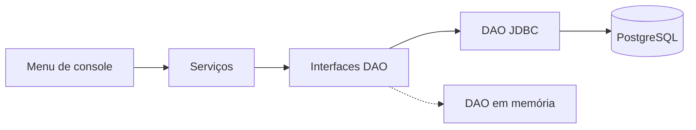

# Portal de Estágios

Aplicação Java de console que conecta **estudantes** a **vagas de estágio**. Empresas publicam e gerenciam vagas,
estudantes se candidatam e administradores cuidam das áreas e acompanham os números do portal.
Os dados ficam em **PostgreSQL**, acessado por **JDBC** com o padrão **DAO**.

> Projeto da disciplina, desenvolvido individualmente — **Entrega 1** (28/10/2026): Java, JDBC e DAO.
> A **Entrega 2** (17/11/2026) evolui o mesmo projeto para API REST com Spring Boot e Spring Security.

## Autoria
**Letícia Santiago da Silva RA: 10420655** — modelagem, implementação, banco de dados, testes e documentação.

## O que o portal faz

| Perfil | O que pode fazer |
|---|---|
| **Visitante** | Cadastrar-se como estudante ou empresa; consultar vagas abertas filtrando por área, modalidade e palavra-chave |
| **Estudante** | Consultar vagas, candidatar-se, ver as próprias candidaturas |
| **Empresa** | Publicar, listar, editar e encerrar suas vagas; ver os candidatos de cada vaga sua |
| **Administrador** | Cadastrar, listar, editar e excluir áreas; consultar as contagens do portal (estudantes, empresas, vagas abertas e encerradas, candidaturas) |

O menu usa **identidade simulada**: escolhe-se um usuário de demonstração. Isso **não é autenticação**; os serviços validam
perfil e propriedade dos registros, e na Entrega 2 o usuário passa a vir do Spring Security.

## Regras de negócio

Cada regra é garantida na camada de serviço e, quando faz sentido, também por uma restrição do banco (defesa em profundidade).

| Regra | Serviço | Banco |
|---|---|---|
| E-mail de usuário único | `UsuarioService` | `UNIQUE (email)` |
| Nome de área único (sem diferenciar maiúsculas) | `AreaService` | índice único em `LOWER(nome)` |
| Só administradores gerenciam áreas | `AreaService` | — |
| Área usada por uma vaga não pode ser excluída | `AreaService` | FK `vaga.area_id` sem `CASCADE` |
| Só empresas publicam vagas; carga horária semanal positiva; campos obrigatórios | `VagaService` | `CHECK (carga_horaria_semanal > 0)` |
| Só a empresa dona edita e encerra a vaga | `VagaService` | — |
| Só estudantes se candidatam | `CandidaturaService` | — |
| Candidatura apenas em vaga aberta | `CandidaturaService` | — |
| Um estudante não se candidata duas vezes à mesma vaga | `CandidaturaService` | `UNIQUE (estudante_id, vaga_id)` |
| Estudante vê só as próprias candidaturas | `CandidaturaService` | — |
| Empresa vê candidatos só das suas vagas | `CandidaturaService` | — |
| Encerrar uma vaga bloqueia novas candidaturas e preserva as anteriores | `VagaService` | situação `ENCERRADA`, sem remoção |
| Contagens administrativas só para administradores | `RelatorioService` | — |

## Arquitetura



| Camada | Pacote | Responsabilidade |
|---|---|---|
| Apresentação | `app` | Lê entradas, chama serviços, mostra resultados e erros. Sem regra de negócio e sem SQL |
| Modelo | `model` | Usuário, Área, Vaga, Candidatura e enums (`Perfil`, `Modalidade`, `SituacaoVaga`) |
| Serviço | `service` | Validação, regras de negócio, autorização por perfil e por propriedade |
| DAO (interfaces) | `dao` | Contrato de persistência independente de tecnologia |
| DAO (JDBC) | `dao.jdbc` | SQL parametrizado, mapeamento de `ResultSet` para objetos, tradução de `SQLException` |
| DAO (memória) | `dao.memoria` | Mesma interface, sem banco: usada nos testes automatizados |
| Exceções | `excecao` | Hierarquia de erros do domínio |

As dependências são entregues pelo construtor e montadas em um único lugar (`app.Contexto`). Trocar memória por
PostgreSQL muda apenas a fábrica usada, sem alterar nenhum serviço.

Exemplo, o caminho de uma candidatura: o menu chama `CandidaturaService.candidatar(ator, vagaId)`, que confere o perfil,
a vaga aberta e a duplicidade antes de chamar `CandidaturaDao.salvar`; o DAO JDBC executa o `INSERT` com `PreparedStatement`.
Detalhes em [docs/camadas.md](docs/camadas.md).

## Modelo de domínio


Uma empresa publica várias vagas, uma vaga recebe várias candidaturas e um estudante se candidata a várias vagas:
`Candidatura` é a associação entre estudante e vaga. Esquema das tabelas e restrições em
[docs/esquema-tabelas.md](docs/esquema-tabelas.md).

## Decisões de projeto

- **Um único `Usuario` com enum `Perfil`, sem herança.** As diferenças entre perfis são dois campos opcionais (`curso` e
  `nomeEmpresa`), então uma tabela única simplifica o DAO e a identidade simulada. O banco garante a coerência com um `CHECK`.
- **`Candidatura` como classe própria.** Ela tem dado próprio (a data) e precisa de restrição de unicidade; uma lista dentro
  de `Vaga` ou `Usuario` não expressaria isso.
- **O ator é parâmetro dos serviços.** A identidade de quem executa vem do usuário selecionado, nunca de um id de "dono"
  informado na entrada; os serviços validam perfil e propriedade antes de qualquer operação.
- **Serviços não conhecem `java.sql`.** O DAO JDBC converte `SQLException` em exceções do domínio; violações de restrição do
  banco (unicidade, chave estrangeira, check) viram mensagens de regra de negócio.
- **Interface funcional e lambda em operações úteis.** `Predicate<Vaga>` combinados com `or` na busca por palavra-chave
  (`VagaService`), `Comparator` para ordenar candidatos por nome (`CandidaturaService`) e uma interface funcional para
  preencher parâmetros de `PreparedStatement` sem repetir código (`UsuarioDaoJdbc`).
- **Credenciais fora do código.** Variáveis de ambiente ou arquivo `.env` ignorado pelo Git.

## Robustez

- Consultas **parametrizadas** (`PreparedStatement`) e recursos fechados com *try-with-resources*.
- Entradas inválidas (opção de menu, número, e-mail, modalidade) e falhas do banco são tratadas no menu: o programa mostra
  uma mensagem e continua, sem encerrar de forma inesperada.
- Hierarquia de exceções: `ValidacaoException`, `RegraNegocioException`, `AcessoNegadoException`,
  `EntidadeNaoEncontradaException` e `PersistenciaException`.

## Testes e verificação

- **10 testes automatizados** (`RegrasDeNegocioTest`), incluindo os três obrigatórios: candidatura duplicada, candidatura em
  vaga encerrada e acesso a vaga de outra empresa. Usam os DAOs em memória, então rodam sem banco (`mvn test`).
- **Roteiro manual com 30 cenários** (entrada, resultado esperado e observado) em
  [docs/roteiro-verificacao.md](docs/roteiro-verificacao.md), cobrindo regras de negócio, persistência após reiniciar e falhas do banco.

## Uso de IA

A IA foi usada como ferramenta de desenvolvimento, em incrementos pequenos, com revisão do código e decisões que o autor consegue explicar e verificar.
As interações relevantes estão em [docs/registro-ia.md](docs/registro-ia.md).

## Estrutura do repositório

```
src/main/java/br/portal/
 ├─ app/       Main, Menu, Console, Contexto, DadosDemonstracao
 ├─ model/     Usuario, Area, Vaga, Candidatura, Perfil, Modalidade, SituacaoVaga
 ├─ service/   Usuario, Area, Vaga, Candidatura, Relatorio + Validacao
 ├─ dao/       interfaces; jdbc/ (PostgreSQL) e memoria/ (testes)
 └─ excecao/   exceções do domínio
src/test/java/ testes das regras de negócio
sql/           01_schema.sql, 02_dados.sql, 03_supabase_rls.sql (opcional)
docs/          modelo, esquema, camadas, roteiro de verificação, registro de IA, execução
```

## Como executar

Resumo (detalhes, uso do Supabase, execução sem Maven e solução de problemas em [docs/execucao.md](docs/execucao.md)):

1. Crie o banco e execute `sql/01_schema.sql` e `sql/02_dados.sql`.
2. Copie `.env.example` para `.env` e preencha URL, usuário e senha do banco.
3. Rode `mvn compile exec:java` na raiz do projeto.

## Próximos passos: Entrega 2

O mesmo projeto evolui para **Spring Boot**: controllers REST e DTOs com validação de entrada, autenticação por sessão com
**Spring Security** (senha com `BCrypt`, login e logout, proteção CSRF) e autorização por perfil e propriedade no backend.
Modelo, serviços e DAOs são reaproveitados; a identidade simulada é substituída pelo usuário autenticado e a tabela
`usuario` ganha o hash da senha.

## Documentação

[Modelo de domínio](docs/modelo-dominio.md) · [Esquema das tabelas](docs/esquema-tabelas.md) ·
[Camadas](docs/camadas.md) · [Roteiro de verificação](docs/roteiro-verificacao.md) ·
[Registro de IA](docs/registro-ia.md) · [Como executar](docs/execucao.md)


