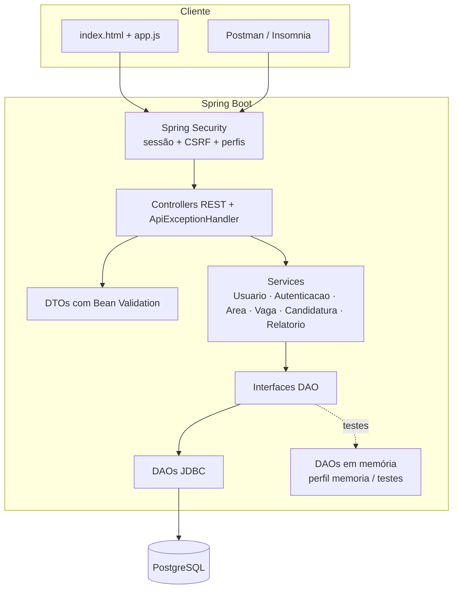

# Arquitetura da Entrega 2

## Quem decide o quê
| Decisão | Onde |
|---|---|
| Está logado? Qual perfil pode chamar a rota? | `SecurityConfig` (401 / 403) |
| A vaga é desta empresa? O estudante é o dono da candidatura? | `VagaService` / `CandidaturaService` (403) |
| Candidatura duplicada, vaga encerrada, área em uso, e-mail repetido | Services (409) |
| Campos obrigatórios, e-mail, tamanho, carga > 0, senha | DTO (400) e Services (rede de segurança) |
| Converter exceção em código HTTP | `ApiExceptionHandler` |

## Fluxo de uma candidatura (API)
1. A interface envia `POST /api/vagas/7/candidaturas` com a sessão e `X-XSRF-TOKEN`.
2. `SecurityConfig` confirma `ROLE_ESTUDANTE` (senão 401/403) e o `CsrfFilter` confere o token.
3. `CandidaturaController` obtém o **usuário pela autenticação** (nunca por id enviado) e chama `CandidaturaService.candidatar`.
4. O Service exige vaga aberta e candidatura inexistente (senão `RegraNegocioException` → 409) e chama o DAO.
5. `CandidaturaDaoJdbc` faz o `INSERT`; a restrição `UNIQUE (estudante_id, vaga_id)` é a segunda linha de defesa.
6. O controller responde 201 com `CandidaturaResponse` (DTO).

## Domínio
Inalterado em relação à Entrega 1 (`docs/modelo-dominio.md`). O hash da senha existe apenas na coluna `usuario.senha`
e no DAO (`UsuarioDao.Credencial`); o objeto `Usuario` não o carrega, então ele não tem como vazar numa resposta.
