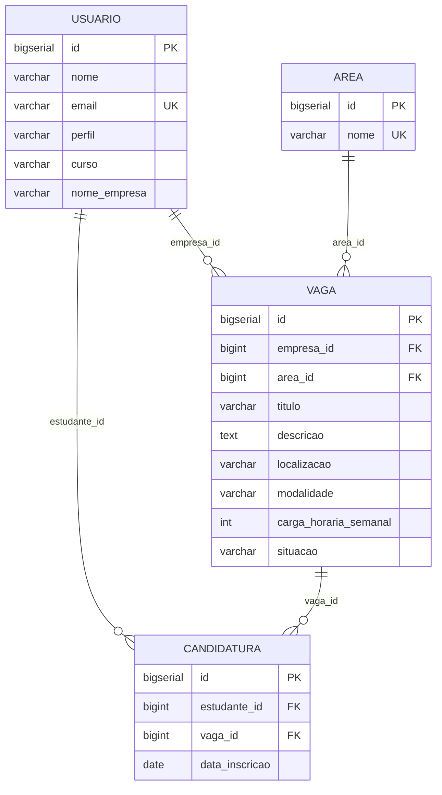

# Esquema das tabelas (PostgreSQL)

Script completo: [`sql/01_schema.sql`](../sql/01_schema.sql).

| Restrição | Onde | Para que serve |
|---|---|---|
| `UNIQUE (email)` + `CHECK (email = LOWER(email))` | usuario | e-mail único |
| `UNIQUE (LOWER(nome))` | area | nome de área único, sem diferenciar maiúsculas |
| `UNIQUE (estudante_id, vaga_id)` | candidatura | impede candidatura repetida |
| FK `vaga.area_id → area.id` (sem CASCADE) | vaga | o banco também impede excluir área em uso |
| FK `vaga.empresa_id`, `candidatura.*` | vaga, candidatura | integridade referencial |
| `CHECK (carga_horaria_semanal > 0)` | vaga | carga horária positiva |
| `CHECK` de perfil, modalidade, situação e dos campos curso/nome_empresa | usuario, vaga | valores válidos |

Limite do banco: ele não garante que `vaga.empresa_id` aponte para um usuário de perfil EMPRESA nem que
`candidatura.estudante_id` aponte para um ESTUDANTE. Isso é garantido pela camada de serviço.
