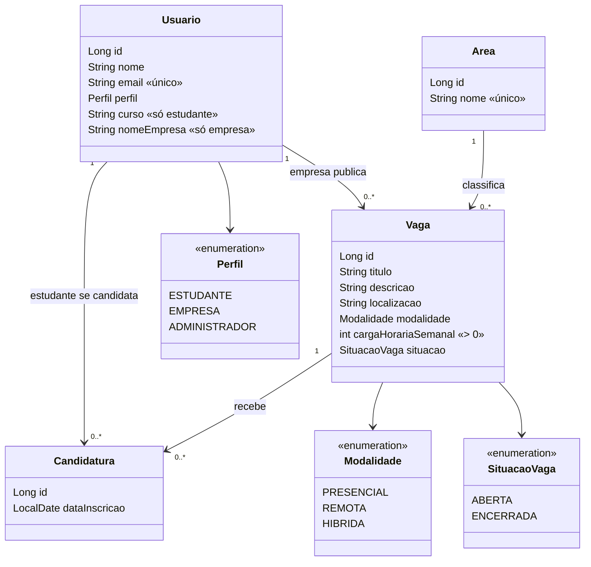

# Modelo de domínio

## Quem é responsável por cada informação
- **Usuario**: identidade, e-mail único e perfil. `curso` só existe para estudante; `nomeEmpresa`, só para empresa.
- **Area**: nome único; só o administrador cria, edita e exclui.
- **Vaga**: pertence a uma única empresa (dona) e a uma única área; só a dona edita e encerra.
- **Candidatura**: é a associação estudante–vaga (N:N) com data de inscrição; o par (estudante, vaga) é único.

## Decisões a justificar
- Perfis em uma única classe (`Usuario` + enum `Perfil`), sem herança: as diferenças são só dois campos opcionais,
  e uma tabela única simplifica o DAO e a identidade simulada.
- `Candidatura` como classe própria (e não lista dentro de `Vaga`/`Usuario`) porque carrega dado próprio (data) e precisa de restrição de unicidade.
- Vaga encerrada continua no banco (situação `ENCERRADA`) para preservar as candidaturas anteriores.
